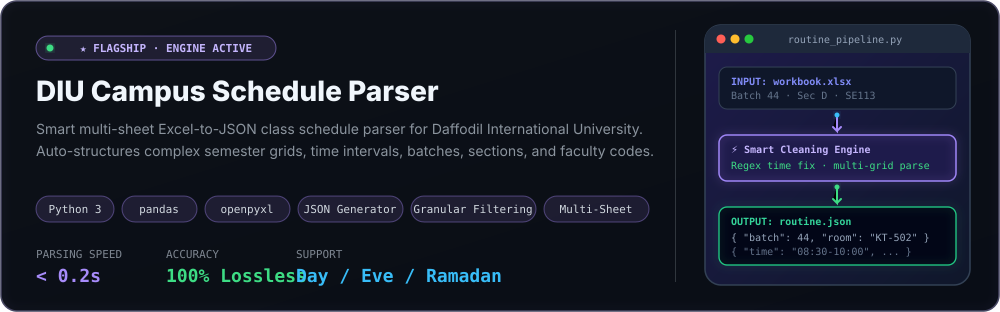
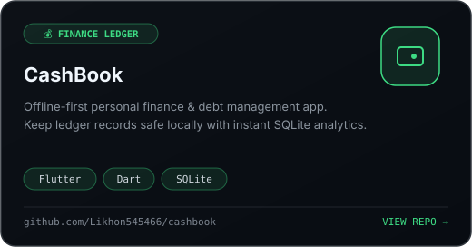
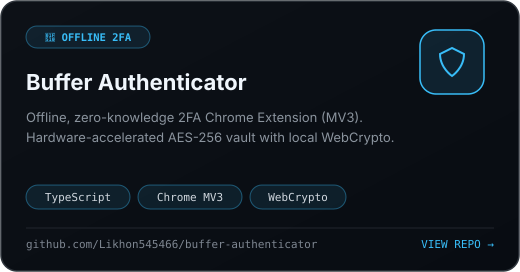
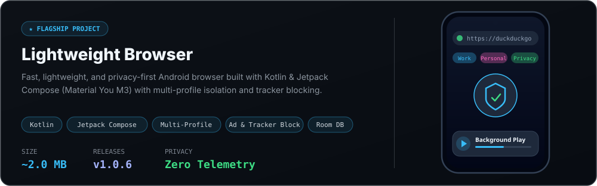
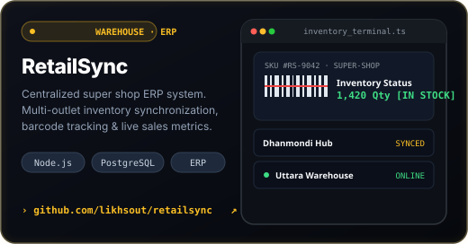
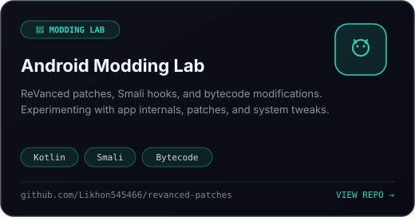
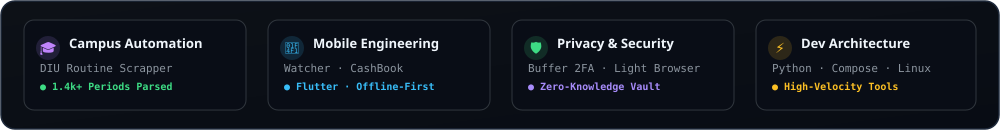
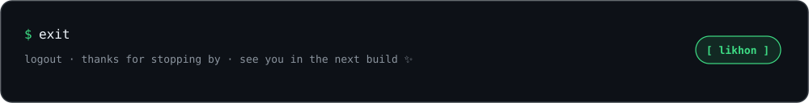

<!--
  ┌───────────────────────────────────────────────────────────────┐
  │  likhon · profile README                                      │
  │  psst — you're reading the source. persist.likhon.curious=true│
  └───────────────────────────────────────────────────────────────┘
-->

<!-- phones (≤600 px wide) get a stacked, large-type version of every graphic -->
<picture>
  <source media="(max-width: 600px)" srcset="https://raw.githubusercontent.com/Likhon545466/Likhon545466/main/assets/header-mobile.svg" />
  
</picture>

  
  
  
  
  

Hey, I'm **Likhon** Story Ends!
## `Featuring...`

<a href="https://github.com/Likhon545466/DIU_Routine_Scrapper">
  <picture>
    <source media="(max-width: 600px)" srcset="https://raw.githubusercontent.com/Likhon545466/Likhon545466/main/assets/card-diu-mobile.svg" />
    
  </picture>
</a>

  <a href="https://github.com/Likhon545466/watcher"><picture><source media="(max-width: 600px)" srcset="https://raw.githubusercontent.com/Likhon545466/Likhon545466/main/assets/tile-watcher.svg" /></picture></a>
  <a href="https://github.com/Likhon545466/cashbook"><picture><source media="(max-width: 600px)" srcset="https://raw.githubusercontent.com/Likhon545466/Likhon545466/main/assets/tile-cashbook.svg" /></picture></a>
  <a href="https://github.com/Likhon545466/buffer-authenticator"><picture><source media="(max-width: 600px)" srcset="https://raw.githubusercontent.com/Likhon545466/Likhon545466/main/assets/tile-2fa.svg" /></picture></a>
  <a href="https://github.com/Likhon545466/lightweight_browser"><picture><source media="(max-width: 600px)" srcset="https://raw.githubusercontent.com/Likhon545466/Likhon545466/main/assets/tile-browser.svg" /></picture></a>
  <a href="https://github.com/Likhon545466/retailsync"><picture><source media="(max-width: 600px)" srcset="https://raw.githubusercontent.com/Likhon545466/Likhon545466/main/assets/tile-retailsync.svg" /></picture></a>
  <a href="https://github.com/Likhon545466/revanced-patches"><picture><source media="(max-width: 600px)" srcset="https://raw.githubusercontent.com/Likhon545466/Likhon545466/main/assets/tile-roms.svg" /></picture></a>

## 📊 `Activity & Stats`

<picture>
  <source media="(max-width: 600px)" srcset="https://raw.githubusercontent.com/Likhon545466/Likhon545466/main/assets/highlights-mobile.svg" />
  
</picture>

  

  
  
  

<picture>
  <source media="(prefers-color-scheme: dark)" srcset="https://raw.githubusercontent.com/Likhon545466/Likhon545466/output/snake-dark.svg" />
  <source media="(prefers-color-scheme: light)" srcset="https://raw.githubusercontent.com/Likhon545466/Likhon545466/output/snake-light.svg" />
  
</picture>

## 🧰 `Toolbox`

  <b>🚀 Languages &amp; Core</b> 
    
  <b>📱 Mobile &amp; Frameworks</b> 
    
  <b>🛠️ Tools, Environments &amp; Databases</b> 
  

## 📡 `Say Hello to likhon`

Got an idea for the DIU Routine Scrapper? Found a bug or want a feature in Watcher, CashBook, or Lightweight Browser? Open an issue, send a PR, or just say hi 👋

  
  
  
  

 

<picture>
  <source media="(max-width: 600px)" srcset="https://raw.githubusercontent.com/Likhon545466/Likhon545466/main/assets/footer-mobile.svg" />
  
</picture>

  

